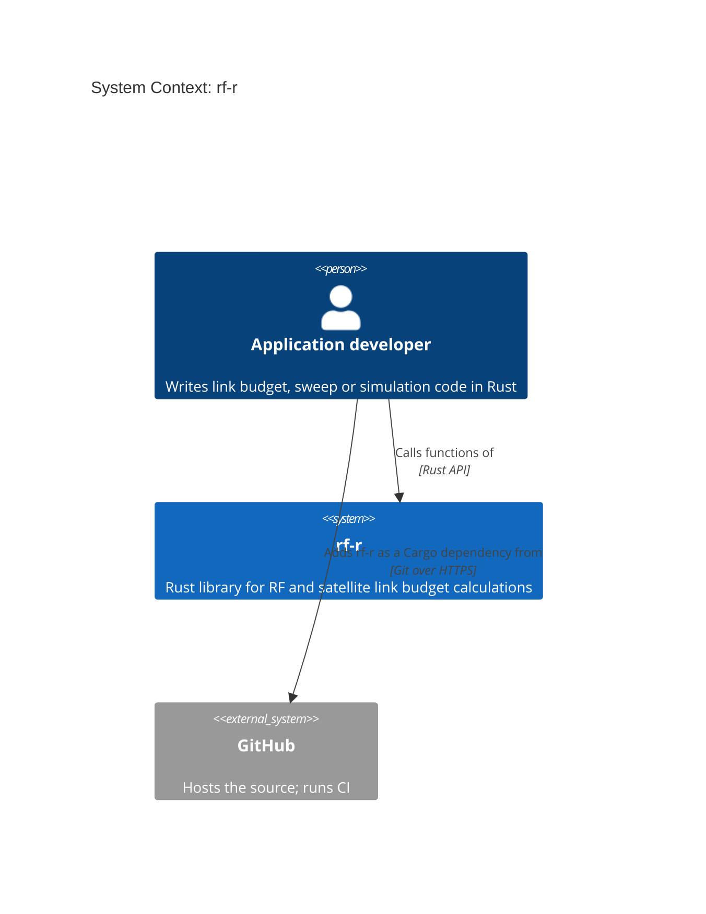

# C4 level 1: System context

`rf-r` is a library linked into the developer's program. It has no runtime connections to other systems.

Elements:
- **Application developer**: anyone building RF tooling in Rust.
- **rf-r**: this crate.
- **GitHub**: source hosting and CI. Only involved at build time.
