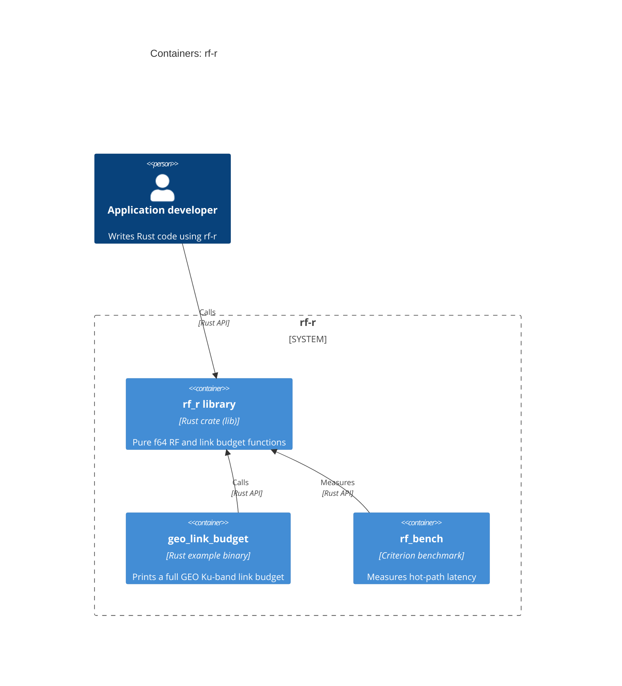

# C4 level 2: Containers

`rf-r` is a single container: the `rf-r` library crate, compiled into the caller's binary.
Benchmarks and examples are development-only targets of the same crate.

Elements:
- **rf_r library**: `src/`.
- **geo_link_budget**: `examples/geo_link_budget.rs`.
- **rf_bench**: `benches/rf_bench.rs`.
